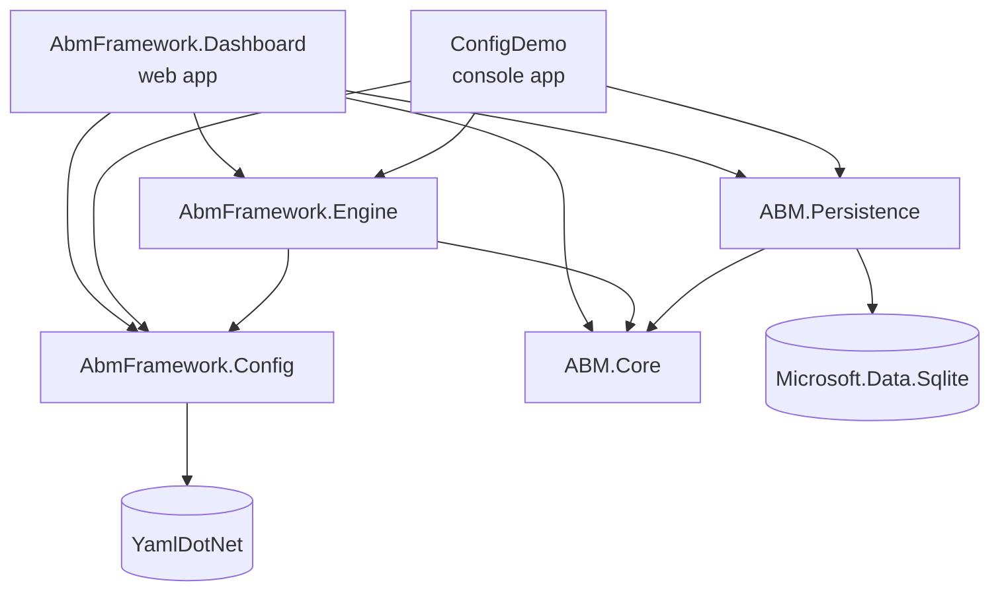
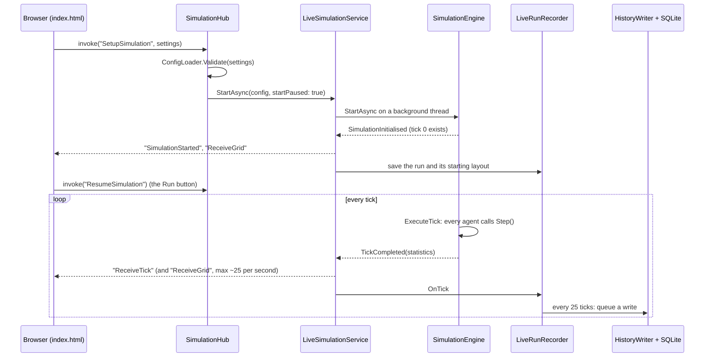
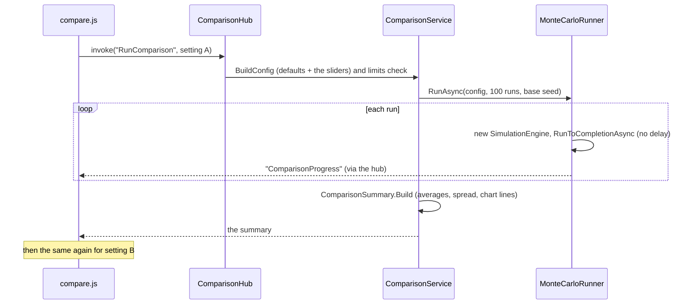

# How ABM.NET fits together

This page explains the big picture: which project does what, how they depend on each other, and what happens when you press the buttons on the dashboard. Every source file also starts with a header comment explaining its own job, so once you know where to look, open the file and read the top.

## The projects

| Project | Kind | Its one job |
|---|---|---|
| `ABM.Core` | Class library | The agents (SIR, Schelling, Boids, Ant, Sheep, Wolf), the grid (`Grid2D`) and its cells (`Patch`). Knows nothing about running, saving or showing. |
| `config-module/AbmFramework.Config` | Class library | `SimulationConfig` (every setting for a run) and `ConfigLoader` (reads JSON/YAML files and validates settings). |
| `config-module/AbmFramework.Engine` | Class library | `SimulationEngine` runs a simulation tick by tick. Also the schedulers, the Monte Carlo runner and the Compare maths (`ComparisonSummary`). |
| `ABM.Persistence` | Class library | The SQLite database (`SimulationRepository`) and the Excel, CSV and JSON exporters. |
| `AbmFramework.Dashboard` | ASP.NET Core web app | The dashboard you run. Hosts the web page, streams live runs to the browser with SignalR, runs Compare batches and serves Past runs and downloads. |
| `config-module/ConfigDemo` | Console app | Runs a scenario file from the command line, without the dashboard. |
| `*.Tests` (4 projects) | xUnit tests | 177 tests. See [TESTING.md](TESTING.md). |

## Who depends on whom

An arrow means "uses". Nothing points back up, so the engine never knows about the web page or the database. That is what lets the same engine run the dashboard, the console app, Compare and the tests.

Note: `AbmFramework.Config` does not reference `ABM.Core`, which is why both have their own `GridTopology` enum. The engine translates between them.

## What happens when you press Setup and Run

Things worth knowing:

- **One live run at a time.** `LiveSimulationService` is a singleton, so every open browser tab sees the same run.
- **The page never asks for updates.** The server pushes them over SignalR (WebSockets). Message names like `"ReceiveTick"` are plain strings in both `LiveSimulation.cs` and `index.html`, so rename them in both places.
- **Saving never slows the simulation.** `LiveRunRecorder` only copies numbers into lists on the engine thread. `HistoryWriter` writes them to SQLite on its own background thread, one job at a time.
- **Every message carries a `runId`.** After Reset or a new Setup, late messages from the old run are ignored by the page.

## Inside one tick

`SimulationEngine.ExecuteTick()`:

1. The scheduler picks the order (`RandomScheduler` shuffles, `SequentialScheduler` keeps the order).
2. For each living agent: get its neighbours from the grid, call `agent.Step(neighbours, random, grid)`.
3. Sync the grid: move agents that changed position, remove dead ones, add queued babies.
4. Schelling only: the engine moves unhappy agents to an empty cell (the agent can't see the whole grid).
5. After all agents: whole-grid processes. Grass regrows (Wolf-Sheep), pheromone fades (Ant Foraging).
6. `BuildStatistics()` counts what happened and `TickCompleted` is raised.

## Repeatability (why the seed matters)

Every bit of randomness in a run comes from ONE `Random` object made from `config.RandomSeed`. Same seed + same settings = exactly the same run, every time. Three features are built on this:

- **Continue** (Past runs): only the settings and seed are saved, not the whole world. To continue, the dashboard replays the run from tick 0 as fast as possible up to where it stopped, then pauses there. See `LiveSimulationService.ContinueAsync`.
- **Compare**: one base seed generates the seed of each of the 100 runs, so the whole batch can be repeated.
- **Tests**: a test can set a seed and expect exact numbers.

So: never use `new Random()` inside a model. Always use the `rng` passed into `Step()`.

## Compare (Monte Carlo)

The Compare panel has its own hub and doesn't touch the live run, so you can compare while a live run is paused.

## The web page

| File | What it does |
|---|---|
| `wwwroot/index.html` | The page layout, its styles and the main script: settings panel, chart, monitors, inspector, buttons and the SignalR connection. |
| `wwwroot/js/grid.js` | Draws the grid canvas, the agent icons and the legend. |
| `wwwroot/js/compare.js` | The Compare pop-up. Self-contained, talks to `/comparisonHub`. |
| `wwwroot/js/history.js` | The Past runs pop-up. Uses the `/api/history` REST endpoints. |
| `wwwroot/css/*.css` | Styles for the two pop-ups. |

Chart.js and the SignalR client are loaded from a CDN, so the page needs internet the first time.

## Where to go next

- Running it for the first time: [GETTING-STARTED.md](GETTING-STARTED.md)
- Adding your own model: [ADDING-A-MODEL.md](ADDING-A-MODEL.md)
- The database tables: [DATABASE.md](DATABASE.md)
- Things to watch out for: [KNOWN-ISSUES.md](KNOWN-ISSUES.md)
