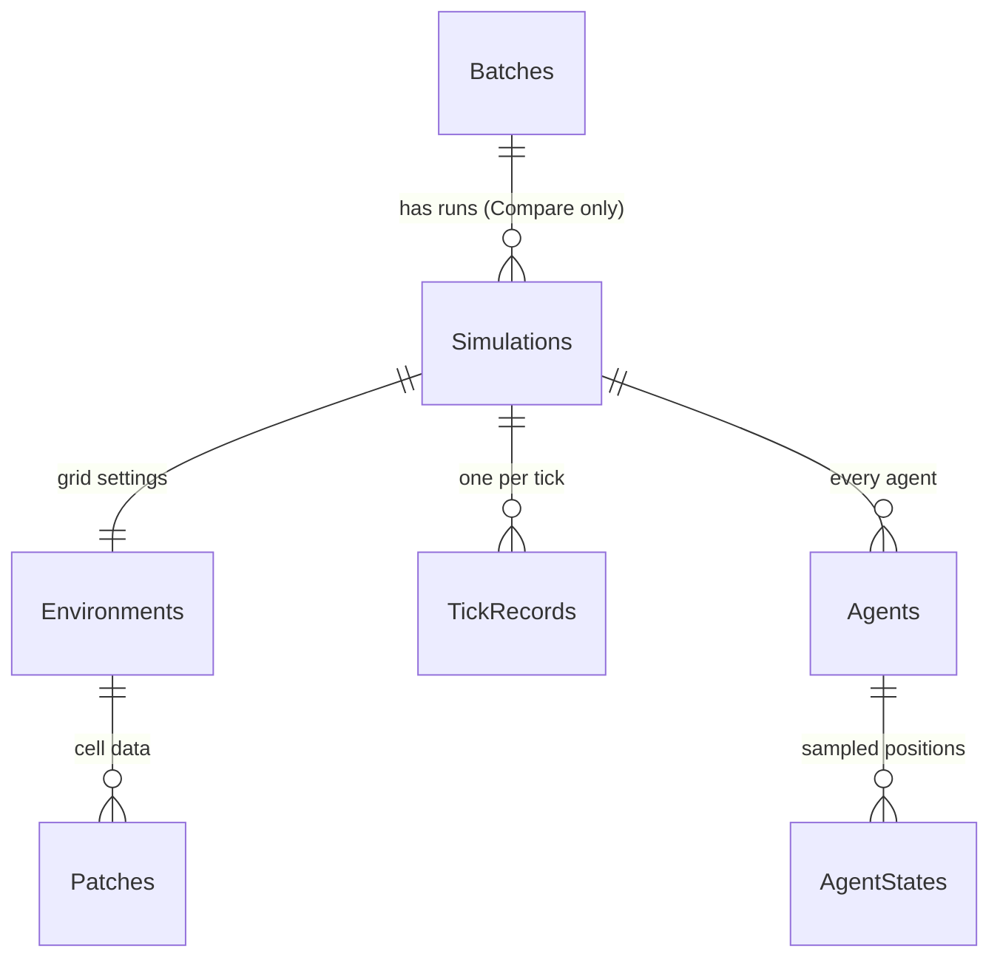

# The database

Every live run and every comparison is saved to a **SQLite** database: a single file, no server to install. The dashboard creates it the first time it starts.

## Where is the file?

- Windows: `%LOCALAPPDATA%\PRJ381-ABM\abm.db` (paste that into the File Explorer address bar)
- Linux/Mac: `~/.local/share/PRJ381-ABM/abm.db`
- The exact path is shown at the bottom of the **Past runs** window and in the console when the dashboard starts.

It is outside the project folder on purpose, so it is never committed to Git and OneDrive doesn't try to sync it while it's being written.

To use a different file, set the `Database:Path` setting, for example the environment variable `Database__Path=C:\temp\test.db`.

`ConfigDemo` uses its own `simulations.db` next to the program (in its `bin` folder), with the same tables.

To look inside, open the file with **DB Browser for SQLite** (close the dashboard first, or open it read-only).

## The tables

| Table | One row per | Main columns |
|---|---|---|
| **Simulations** | run (live, Compare or console) | Model, Source (`Live`, `Compare`, `Console`), Status, StartedAt, EndedAt, TickCount, Seed, ConfigurationJson (all settings), BatchId, RunNumber |
| **Environments** | run | GridWidth, GridHeight, Topology, Scheduler |
| **TickRecords** | tick of a run | Susceptible, Infected, Recovered (SIR), TotalPopulation, MetricsJson (every other model's numbers) |
| **Agents** | agent that ever existed in a live run | Breed, FirstTick, LastTick |
| **AgentStates** | agent at a sampled tick | X, Y, State, PropertiesJson (energy, heading...). Saved at Setup (tick -1), every 10 ticks or more, and at the end |
| **Patches** | interesting cell at Setup and at the end | X, Y, PropertiesJson (grass, food, nest, pheromone) |
| **Batches** | Compare batch (setting A or B) | GroupId (shared by A and B), Label, Runs, BaseSeed, ConfigurationJson, PageSettingsJson, SummaryJson |

Deleting a row deletes everything that belongs to it (`ON DELETE CASCADE`), so deleting a run removes its ticks, agents and patches too.

Values that differ per model (metrics, agent properties, patch data, settings) are stored as JSON text. That's why a new model doesn't need new tables.

## The code

| File | Job |
|---|---|
| `ABM.Persistence/Database/DatabaseInitializer.cs` | Creates the tables (the SQL is here). |
| `ABM.Persistence/SimulationRepository.cs` | Every query. The rest of the app only uses the `IRepository` interface. |
| `ABM.Persistence/Models/*.cs` | One C# class per table. |
| `AbmFramework.Dashboard/History/HistoryWriter.cs` | Owns the database in the dashboard, does every write on one background thread. |
| `AbmFramework.Dashboard/History/LiveRunRecorder.cs` | Decides what to save for a live run, and when. |

## Changing a table (careful!)

The database remembers which version of the tables it has (SQLite's `user_version`). When the app starts and the file is older than `DatabaseInitializer.SchemaVersion`, **the old tables are dropped and rebuilt, deleting every saved run**.

So, to add a column or table:

1. Change the `CREATE TABLE` in `DatabaseInitializer.CreateStatements` (and `DropOldTables` for a new table).
2. Add the property to the model class in `Models/`.
3. Update the matching `Bind...`, `Read...` and `SELECT` code in `SimulationRepository.cs`.
4. Bump `SchemaVersion` by one.
5. Tell your team: their Past runs will be wiped the next time they run the app.

If saved runs ever start to matter (for example real research data), replace step 4 with a proper migration: an `ALTER TABLE` that runs when the version is old, instead of dropping everything.
